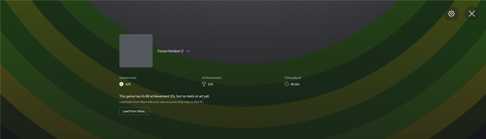
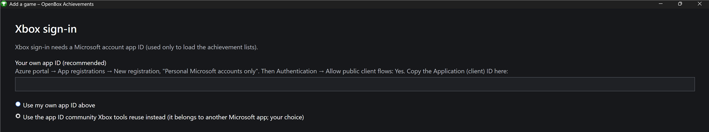
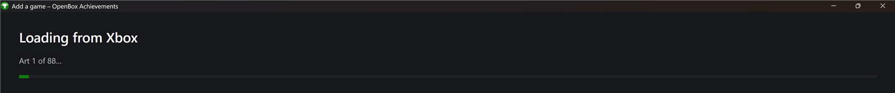

# OpenBox Achievements

Xbox-style achievements for console games played on PC, offline: an
achievements page, unlock pop-ups, a Game Bar widget and full controller
support. Achievements unlock as you play, decided by the game's mod; OpenBox
shows them.



> OpenBox Achievements is an independent project. It is **not affiliated
> with, endorsed by or sponsored by Microsoft, Xbox or any game publisher.**
> "Xbox" and game names are trademarks of their owners and are used only to
> describe compatibility.

## Supported games

| Game | Support |
|---|---|
| Forza Horizon 2 | full: unlocks while you play, with [Forza Horizon 2 Extra Options](https://github.com/RokkuDayo/ForzaHorizon2_ExtraOptions) and the [OpenBox Achievements plugin](https://github.com/byzyn4ik/FH2-ExtraOptions-OpenBox-Achievements-) |
| Forza Horizon 2 Presents Fast & Furious | base |
| Forza Horizon 3 | base |
| Forza Motorsport 5 | base |
| Forza Motorsport 6 | base |

**Base** support: the game is already listed with its achievements. Load their
texts and art from Xbox, and optionally the achievements your Xbox account has
already unlocked. Unlocking while you play needs a mod for that game.

Any other game with achievements can be added for viewing: Settings → **Add
game…**.

## Install

1. Download from [Releases](../../releases) either the setup,
   `OpenBoxAchievements-<version>.msi` (installs for your Windows account,
   no administrator needed, with a Start menu shortcut), or
   `OpenBoxAchievements-<version>.zip` (unzip anywhere).
2. Start OpenBox Achievements. It runs in the tray. With Extra Options,
   the game starts it and opens it from the pause menu's **Achievements**
   button.

Requires Windows 10 or 11 (.NET Framework 4.8, built in).

## Setup: load the achievements from Xbox

OpenBox ships only the achievement IDs. Their names, descriptions and pictures
are loaded once from Xbox with your own Microsoft account and stay on your PC.
It takes a few minutes.

Step-by-step guide with all screenshots: **[GUIDE.md](guide/GUIDE.md)**
(English and Ukrainian) or as a **[PDF](guide/Open-Achivements-GUIDE.pdf)**.

**1. Click Load from Xbox…** on the game's page (screenshot above).

**2. Choose the sign-in app ID.** The easiest choice is *Use the app ID
community Xbox tools reuse instead*; then click **Continue**. To use your own
ID instead: Azure portal → App registrations → New registration, *Personal
Microsoft accounts only*; Authentication → *Allow public client flows*: Yes;
paste the Application (client) ID.



**3. Sign in with the code.** Open **microsoft.com/link** in any browser, sign
in with your Xbox account, type the code the app shows and click **Allow
access**. The app continues by itself.

**4. Wait for the download.** The app loads the texts, then the art. When it
finishes, every achievement is listed with its picture, Gamerscore and
progress.



## Using it

| Controller | Keyboard / mouse | Action |
|---|---|---|
| D-pad, left stick | arrow keys | move |
| A | Enter, click | open a card or list |
| B | Esc | back, close |
| X / Y | – | filter / sort |
| Menu | gear button | Settings (add, remove games) |
| LB / RB | – | previous / next game |
| right stick | wheel | scroll |

The app is in English or Ukrainian: the Windows display language by default,
or Settings → Language. Achievement texts are shown as Xbox provides them.

Command line: `--game <id>` opens that game, `--background` starts in the
tray, `--test-toast` shows a sample unlock. `--import --game <id>` opens the
wizard straight on loading that game from Xbox (sign-in, then the download;
the Xbox title ID comes from its manifest), e.g. `--import --game fh2` for
Forza Horizon 2 – installers use it when the game has no texts and art yet.
Without `--game`, or for a game OpenBox does not know, `--import` opens the
Add a game wizard. If OpenBox is already running, the running copy opens the
wizard.

## Privacy

Xbox Live is used only to load achievement lists, texts and art (and, if you
choose **Obtain progress from the account**, which achievements you have
unlocked). Nothing is sent back, and the app has no telemetry. The sign-in
token is stored in `%LOCALAPPDATA%\OpenBoxAchievements\account.bin`, encrypted
for your Windows account.

## How it works

OpenBox has no achievement rules. Each game's mod decides when an achievement
unlocks and sends OpenBox only the results over the local pipe
`\\.\pipe\OpenBoxAchievements.Events.v1`; OpenBox records them and shows the
pop-up, the page and the widget. For Forza Horizon 2, achievements reach
OpenBox through [Forza Horizon 2 Extra Options](https://github.com/RokkuDayo/ForzaHorizon2_ExtraOptions)
0.3.2+ with the [OpenBox Achievements plugin](https://github.com/byzyn4ik/FH2-ExtraOptions-OpenBox-Achievements-)
in its `mods` folder: the plugin evaluates the FH2 rules in game (they ship
with the plugin) and sends OpenBox only the unlocks and progress.

- **Manifests** (`games\<id>\achievement_manifest.json`) list each game's
  achievement IDs and nothing else, so they can be shared. See
  [docs/MANIFEST.md](docs/MANIFEST.md).
- **Mods** send `unlocked` and `progress` messages and resend until OpenBox
  confirms, so nothing is lost while it is closed. See
  [docs/EVENTS.md](docs/EVENTS.md).
- **Your data** (texts, art, unlocks, progress, settings) stays in
  `%LOCALAPPDATA%\OpenBoxAchievements`.

## Adding a game

1. Settings → **Add game…** → Xbox game. This creates
   `games\<id>\achievement_manifest.json` with the achievement IDs.
2. Set `Process` in it to the game's EXE name (for time played).
3. Have the game's mod send its results (see [docs/EVENTS.md](docs/EVENTS.md)).
4. Share the manifest: pull requests are welcome.

## Building

```powershell
.\build.ps1                          # Release → bin\
.\build.ps1 -Configuration Debug     # Debug   → bin-debug\
```

Needs Visual Studio 2019+ or the Visual Studio Build Tools (the C# compiler);
no NuGet packages. The setup is built with
[WiX 3.14](https://github.com/wixtoolset/wix3/releases):

```powershell
.\installer\build.ps1 -Wix <wix314 folder> -Version 0.0.1   # → installer\bin\OpenBoxAchievements-0.0.1.msi
```

The Xbox Game Bar widget (`widget\`, UWP: Visual Studio with the Universal
Windows Platform workload) is signed with its certificate's private key, which
is not in the repository. Build it and pass it to the setup:

```powershell
.\widget\build.ps1 -KeyFile <OpenBoxWidget.pfx> -Password <password>   # → widget\package\
.\installer\build.ps1 -Wix <wix314 folder> -Version 0.0.1 -Widget widget\package
```

GitHub Actions builds Debug and Release on every branch push; a `v*` tag
builds the Release, the widget and the MSI and publishes them as a release
(the signing key comes from the repository secrets `WIDGET_PFX_BASE64` and
`WIDGET_PFX_PASSWORD`). The icon, the ring artwork and the unlock chime are
original to this project.

## License

[MIT](LICENSE)
